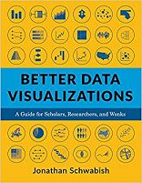
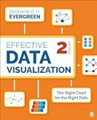
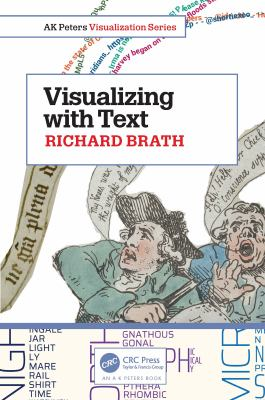
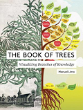

👷🚧 This page is under construction 🚧👷

Welcome to **Tableau and Surveys!** This tutorial supports The Ohio State University Libraries Research Commons [Tableau and Surveys](https://library.osu.edu/events?combine=&tid=All&field_location_code_value=10&sort_bef_combine=field_end_date_value_ASC) workshop series. Building on concepts introduced in the [Tableau for Research](./tableau_for_research.ipynb) workshops, it introduces **INTERMEDIATE** Tableau users to techniques for working with, analyzing, and communicating survey data in Tableau.  

## Learning Objectives

1.	**Prepare and organize survey data** for efficient analysis and visualization in Tableau.
2.	**Create visualizations** that effectively summarize respondent characteristics, opinions, behaviors, and experiences.
3.	**Select appropriate chart types** for communicating results from different survey question formats, including categorical, ordinal, Likert-scale, multiple-response, and open-response questions.
4.	**Develop interactive dashboards and advanced visualizations** that support exploration and interpretation of survey results.
5.	**Design publication ready visualizations and dashboards** that effectively communicate survey findings to academic, professional, and public audiences.

## What to expect

Each lesson combines guided instruction, hands-on examples, and opportunities to practice new skills using survey data. Supplementary readings and resources support continued skill development, introduce data visualization best practices, and showcase examples that can inform and inspire future visualization projects. 

Available through The Ohio State University Libraries, these resources are accessible to faculty, students, and staff, and include:

:::: {.grid .g-4}
::: {.g-col-12 .g-col-md-6 .g-col-lg-4}

  
BETTER DATA VISUALIZATIONS

  
</img><h3 class="card-title"><a href="https://search.library.osu.edu/permalink/01OHIOLINK_OSU/rr4vai/alma991085487354008507">Better Data Visualizations: A Guide for Scholars, Researchers, and Wonks</a></h3>
  

  <ul class="list-group list-group-flush">
    <li class="list-group-item"><strong>by Jonathan Schwabish</strong></li>
    <li class="list-group-item">New York : Columbia University Press, 2021.</li>
  </ul>

:::

::: {.g-col-12 .g-col-md-6 .g-col-lg-4}

  
EFFECTIVE DATA VISUALIZATION

  
<h3 class="card-title"><a href="https://search.library.osu.edu/permalink/01OHIOLINK_OSU/1n38col/cdi_nii_cinii_1130282272283601920">Effective Data Visualization: The Right Chart for the Right Data</a></h3>
  

  <ul class="list-group list-group-flush">
    <li class="list-group-item"><strong>by Stephanie Evergreen</strong></li>
    <li class="list-group-item">Thousand Oaks, California: SAGE Publications, 2020</li>
  </ul>

:::

::: {.g-col-12 .g-col-md-6 .g-col-lg-4}

  
VISUALIZING WITH TEXT

  
<h3><a href="https://search.library.osu.edu/permalink/01OHIOLINK_OSU/l4v3dr/alma991085709546708507">Visualizing with Text</a></h3>
  

  <ul class="list-group list-group-flush">
    <li class="list-group-item"><strong>by Richard Brath</strong></li>
    <li class="list-group-item">Boca Raton, FL: CRC Press, 2021,</li>
  </ul>

:::

::: {.g-col-12 .g-col-md-6 .g-col-lg-4}

  
BOOK OF TREES

  
<h3 class="card-title"><a href="https://search.library.osu.edu/permalink/01OHIOLINK_OSU/b5bq8j/alma9910255715008506">The Book of Trees: Visualizing Branches of Knowledge</a></h3>
  

  <ul class="list-group list-group-flush">
    <li class="list-group-item"><strong>by Manuel Lima</strong></li>
    <li class="list-group-item">New York, New York: Princeton Architectural Press, 2014.</li>
  </ul>

:::

::::

